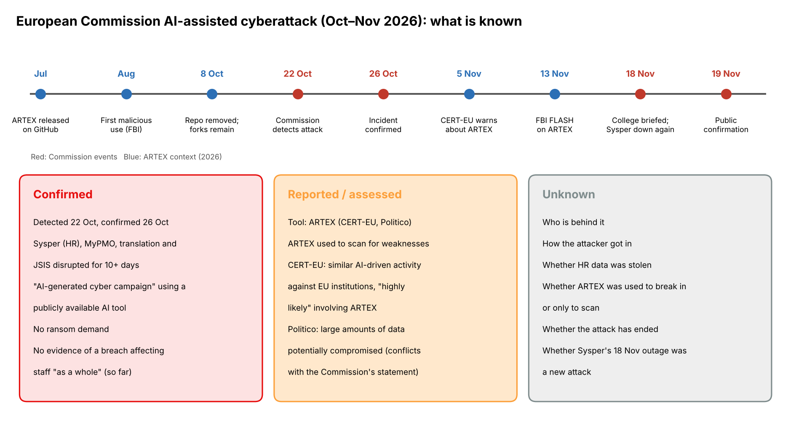

# European Commission AI-Assisted Cyberattack (October–November 2026): Threat Intelligence Assessment

> Portfolio project: a threat-intelligence assessment of the AI-assisted cyber campaign against the European Commission, written while the investigation is still open. It separates what is confirmed from what is reported or assumed, maps the activity to MITRE ATT&CK with confidence levels, weighs competing hypotheses, and gives defenders a hunting and hardening checklist for AI-driven intrusions.
>
> **Framework version:** MITRE ATT&CK Enterprise v20.1 · **Status:** ongoing investigation · **Information cut-off:** 21 November 2026

## 1. Key judgements

| # | Judgement | Confidence | Basis |
| --- | --- | --- | --- |
| 1 | The Commission was hit by an intrusion detected on 22 October and confirmed on 26 October that disrupted internal staff services for more than ten days | **Confirmed** | Commission spokesperson (19 Nov) |
| 2 | The attackers used a publicly available AI tool, highly likely the open-source framework ARTEX | **High** | Commission ("AI-generated cyber campaign", "publicly available" tool); CERT-EU; Politico sources |
| 3 | Much of the visible disruption came from the Commission's own preventive shutdown of applications, not necessarily from destructive attacker actions | **Moderate** | Commission: apps taken down as a "protective and preventive measure"; no ransom demand |
| 4 | Whether staff HR data was stolen is unresolved | **Unknown** | Commission: no evidence of a breach affecting staff "as a whole"; Politico: large amounts of data potentially compromised |
| 5 | The attacker is unidentified; neither a state nor a criminal motive can be ruled out | **Unknown** | No public attribution |
| 6 | The incident fits a wider pattern: AI frameworks let attackers chain known techniques faster, putting overlooked internal web applications at risk | **High** | FBI FLASH (13 Nov), CERT-EU (5 Nov) |

_Confidence wording follows common intelligence practice: **Confirmed** = officially stated; **High / Moderate / Low** = analyst assessment; **Unknown** = no reliable public information._

## 2. Executive summary

On 22 October 2026 the European Commission detected a cyber campaign against its internal systems. To contain it, the Commission took several applications offline: Sysper (HR: payslips, leave, timesheets), MyPMO (medical reimbursements), translation services and the JSIS health-insurance portal were disrupted for more than ten days, and Sysper failed again briefly on 18 November.
The Commission confirmed the incident publicly only on 19 November, describing an "AI-generated cyber campaign" that misused a publicly available AI tool. CERT-EU had warned on 5 November that several threat actors were using ARTEX, an open-source AI penetration-testing framework, and that similar AI-driven activity against EU institutions "highly likely" involved it.
No attacker has been named, no ransom was demanded, and it is not yet known whether HR data (names, grades, home addresses, contact details) was taken. This is the third publicly reported cyber incident at the Commission in 2026.
**Key lesson:** AI tools do not invent new attacks; they compress the time between finding a weakness and exploiting it. Defenders need the same speed: smaller attack surfaces, faster patching, and detections that spot machine-speed behaviour.

## 3. Timeline

| Date (2026) | Event | Source |
| --- | --- | --- |
| January | Commission's central mobile-device infrastructure attacked; staff names and phone numbers potentially exposed | Euronews |
| March | Cloud infrastructure hosting Europa.eu compromised (via a compromised Trivy version); about 92 GB stolen; CERT-EU attributes it to TeamPCP, data leaked by ShinyHunters | CERT-EU, TechCrunch, Euronews |
| July | ARTEX published on GitHub by a developer known as Autumn-27 | FBI via BleepingComputer |
| August | Earliest known malicious use of ARTEX | FBI |
| 8 October | ARTEX repository removed after abuse reports; forks, archives and a commercial "ARTEX PRO" remain | FBI via BleepingComputer |
| **22 October** | **Commission detects the campaign** | Commission |
| **26 October** | **Incident confirmed internally** | Commission via SecurityWeek |
| late Oct – Nov | Sysper, MyPMO, translation and JSIS unavailable for 10+ days; apps taken down preventively | Politico, Euronews |
| 5 November | CERT-EU warns that threat actors worldwide use ARTEX; similar AI-driven activity against its constituency "highly likely" involved ARTEX | CERT-EU |
| 13 November | FBI FLASH on ARTEX: some intrusions reached privileged access in under three hours | FBI |
| 18 November | Corporate Management Board meets; College of Commissioners briefed; Sysper briefly down again | Politico, Euronews |
| **19 November** | **Public confirmation** at the Commission's press briefing | Commission |

## 4. What is ARTEX?

- An **autonomous penetration-testing framework** written in Go and released as open source in July 2026 for authorised testing.
- It has **no AI model of its own**: it connects to external large language models and turns natural-language goals into commands, using AI agents for reconnaissance, vulnerability discovery, exploitation, privilege escalation and data theft.
- It can run intrusions against **many targets at once**, lowering the skill needed for complex operations.
- The FBI links it to criminal and state-aligned campaigns, including a ConnectWise supply-chain breach affecting Microsoft 365 tenants and attacks on South Korean banks. More than 1,600 ARTEX consoles were publicly exposed in early November.
- It favours **overlooked systems**: partner portals, employee applications, legacy services and third-party integrations. An HR platform such as Sysper fits that profile.

## 5. MITRE ATT&CK mapping (with confidence)

Very few technical details of the Commission intrusion are public. The table separates the little that is confirmed from techniques ARTEX has used elsewhere, which are **hypotheses to hunt for**, not findings.

| Tactic | Technique | Status | Evidence |
| --- | --- | --- | --- |
| Resource Development | T1588.007 Obtain Capabilities: Artificial Intelligence | **Confirmed** | "AI-generated cyber campaign" using a publicly available AI tool |
| Resource Development | T1588.002 Obtain Capabilities: Tool | Highly likely | ARTEX (CERT-EU, Politico) |
| Reconnaissance | T1595.002 Vulnerability Scanning | Reported | Politico sources: ARTEX used to scan Commission systems for weaknesses |
| Initial Access | T1190 Exploit Public-Facing Application | Hypothesis | ARTEX campaigns target internet-facing employee and partner apps |
| Initial Access | T1078.004 Valid Accounts: Cloud Accounts | Hypothesis | ARTEX campaign abused application identities in M365 tenants |
| Credential Access | T1110.003 Password Spraying | Hypothesis | Seen in the ConnectWise/M365 ARTEX campaign |
| Persistence | T1505.003 Web Shell | Hypothesis | ARTEX agents deployed web shells in other campaigns |
| Privilege Escalation | T1068 Exploitation for Privilege Escalation | Hypothesis | ARTEX automates escalation; privileged access in under 3 h in some cases |
| Collection | T1213 Data from Information Repositories | Open question | Whether Sysper HR data was accessed |
| Exfiltration | T1041 Exfiltration Over C2 Channel | Open question | No confirmed data theft |

_Navigator layer: [`layers/attack-layer.json`](layers/attack-layer.json) (red = confirmed, orange = reported/highly likely, yellow = hypothesis)._

**Not mapped on purpose:** service disruption (e.g. T1489 Service Stop). The outages were caused at least in part by the Commission's own containment, and there is no public evidence of attacker-caused destruction.

## 6. Competing hypotheses

| Hypothesis | Consistent with | Inconsistent with / missing | Assessment |
| --- | --- | --- | --- |
| **H1. State espionage** (collecting staff data for targeting and recruitment) | HR data (names, grades, addresses) is valuable for intelligence; EU institutions are constant espionage targets; FBI links ARTEX to state-aligned groups | No attribution, no espionage indicators published | Plausible |
| **H2. Criminal data theft / extortion** | ARTEX is widely used by criminals; the Commission's March breach was criminal (TeamPCP, ShinyHunters) | No ransom demand; no leak or sale announced so far | Plausible, weakened by the absence of extortion |
| **H3. Opportunistic automated campaign** (mass AI-driven scanning that found an exposed app) | ARTEX runs against many targets at once; CERT-EU saw similar activity across EU institutions | Duration and depth (10+ days, repeated Sysper outage) suggest more than a scan | Plausible as the **entry**, possibly followed by H1 or H2 |
| **H4. Disruption / hacktivism** | Visible service outages | Outages largely self-imposed; no public claim | Unlikely |

**Indicators that would change the assessment:** a leak-site post or ransom note (supports H2); a government attribution or technical overlap with a known espionage group (supports H1); confirmation that only scanning occurred (supports H3 alone); a public claim (H4).

## 7. Hunting and hardening checklist for AI-driven intrusions

**Hunt for machine-speed behaviour**

| Signal | Why it matters |
| --- | --- |
| Bursts of automated requests against internal or employee web apps, especially many distinct paths in seconds | AI agents enumerate and test far faster than humans |
| Recon → exploit → new privileged session within hours on the same asset | The FBI saw initial targeting to privileged access in under three hours |
| Password-spraying patterns against SSO or app login pages | Used in ARTEX campaigns |
| New web shells or unexpected files in web roots of HR, portal or legacy apps | Web shells deployed by ARTEX agents elsewhere |
| Unexpected credential or privilege changes; new app permissions or OAuth grants | Persistence seen in the M365 campaign |
| Large exports from HR or document systems, or unusual database queries from app servers | Possible collection and exfiltration |
| Connections to exposed ARTEX consoles or IPs in the FBI FLASH | Use the FBI IOC list; expect false positives and fast ageing |

**Harden**

- Keep an inventory of **internal and employee-facing apps** (HR, reimbursement, translation, partner portals) and remove internet exposure where it is not needed; these are the "overlooked" systems AI agents favour.
- Put every staff application behind SSO with **phishing-resistant MFA**, and rate-limit login and sensitive APIs.
- Shorten patch timelines for internet-facing apps; AI tools reduce the time between disclosure and exploitation.
- Review **application identities and permissions** regularly; remove unused ones.
- Pre-plan **containment that limits collateral damage**: the Commission's shutdown protected systems but left staff without pay and leave tools for over ten days.
- Communicate early with affected staff and regulators; MEPs and staff criticised the late, mostly internal communication.

## 8. Intelligence gaps (what to watch for)

- **Initial access vector:** which system and which weakness, and whether ARTEX was used to break in or only to scan.
- **Data impact:** the outcome of DG DIGIT, CERT-EU and European Data Protection Supervisor assessments of HR data.
- **Attribution:** any statement by the Commission, CERT-EU or a member state.
- **Scope:** whether other EU institutions were affected by the same campaign (CERT-EU mentions similar activity across its constituency).
- **Status:** whether the attack has ended; whether the 18 November Sysper outage was a new attack or recovery work.

## 9. Limitations

- Written during an **ongoing investigation**; facts may change. This report reflects public information up to 21 November 2026 and should be versioned when new details appear.
- Most technical details come from **media reporting based on anonymous officials** (Politico, Euronews), not from an official technical report.
- The Commission's statements and Politico's reporting **conflict** on data exposure; both are recorded.
- The ATT&CK hypotheses are drawn from **ARTEX use in other campaigns** and must not be read as findings about the Commission intrusion.

## 10. Sources

- [Euronews: EU Commission hit by large-scale cyberattack with data leakage unknown](https://www.euronews.com/2026/11/19/eu-commission-hit-by-large-scale-cyberattack-with-data-leakage-unknown)
- [SecurityWeek: European Commission Confirms AI-Assisted Cyberattack Disrupted Services](https://www.securityweek.com/european-commission-confirms-ai-assisted-cyberattack-disrupted-services/)
- [Help Net Security: European Commission confirms AI-generated cyberattack](https://www.helpnetsecurity.com/2026/11/20/european-commission-ai-generated-cyberattack-publicly-available-tool/)
- [Computer Weekly: AI red team tool Artex likely behind cyber attack on EU body](https://www.computerweekly.com/news/366654974/AI-red-team-tool-Artex-likely-behind-cyber-attack-on-EU-body)
- [Security Affairs: European Commission Cyberattack, ARTEX AI Tool Suspected](https://securityaffairs.com/203483/hacking/european-commission-cyberattack-artex-ai-tool-suspected-in-prolonged-disruption.html)
- [BleepingComputer: FBI warns ARTEX AI hacking tool is powering global cyberattacks](https://www.bleepingcomputer.com/news/security/fbi-warns-artex-ai-hacking-tool-is-powering-global-cyberattacks/)
- [The Record: FBI flash alert says Artex tool automating cyberattacks at 'machine speed'](https://therecord.media/artex-ai-tool-fbi-flash-alert)
- [TechCrunch: Europe's cyber agency blames hacking gangs for massive data breach and leak (March 2026 incident)](https://techcrunch.com/?p=3109164)
- [CERT-EU](https://cert.europa.eu) · [MITRE ATT&CK](https://attack.mitre.org)

## License & attribution

© 2026 Stelios Partsinevelos. Released under the MIT License (see [LICENSE](LICENSE)).

MITRE ATT&CK® is a registered trademark of The MITRE Corporation; ATT&CK content © The MITRE Corporation. This independent analysis is not affiliated with or endorsed by the European Commission, CERT-EU, MITRE or any vendor named, and is based only on public sources.
